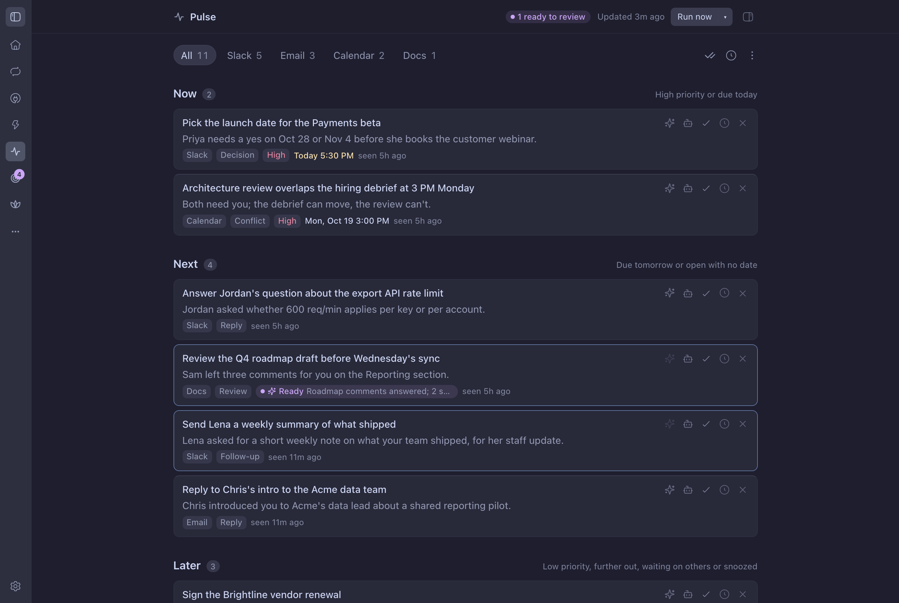

# Pulse

A [bb](https://getbb.app) plugin that shows a live board of what needs you from Slack, Gmail and
Calendar on your Mac. **Pulse on the iPhone does the capturing**; this plugin renders the snapshot
the app publishes and sends your taps back as commands. The board sorts items into **Now**,
**Next**, **Later** and **Nice to Know**.



[Watch the 72-second demo](https://github.com/steveafrost/bb-plugin-pulse/releases/download/v0.1.0/pulse-demo.mp4) (made-up data).

- **A mirror, not a store.** The panel reads `snapshot.json` from the app's iCloud container and
  never writes it. Done, Snooze, Dismiss and Reopen append to `commands.jsonl`; the app applies them
  and republishes. A row shows **Sent to iPhone** until the app acknowledges it.
- **Same board as the phone.** Section placement comes from the app's own rules
  (`lib/horizon.ts`, ported from `PulseCore`'s `HorizonDerivation`), so an item sits in the same
  section on both screens.
- **Quick actions.** Items carry up to three one-click resolutions ("Decline meeting", "Reply
  yes"). A click copies the prepared text and opens the source. Nothing is ever sent for you.
- **Agent threads.** The robot button starts a Mac thread that does the work up to the point of
  review, with the skills you map to that kind of item. The card shows Working, then Ready with the
  thread's one-line summary. These records are Mac-local and stay in the plugin's state directory.

## Setup

1. Install the plugin and Pulse on your iPhone, and let it write its first snapshot.
2. Open **Settings › Plugins › Pulse**. Leave **Mirror directory** empty to use the app's iCloud
   container, or point it at a folder you sync yourself.
3. Optional: pick a **project** (needed for agent threads, and for the legacy Mac schedules, so
   agents can reach Slack, Gmail and Calendar if you turn those back on), your first name, house
   rules, and skill rules (`skill-name | why | regex`, one per line).
4. `bb plugin reload pulse`.

## The three files

All live in the mirror directory ([DATA-CONTRACT.md](https://github.com/steveafrost/pulse-ios/blob/main/docs/DATA-CONTRACT.md)):

| File | Written by | Read by |
| --- | --- | --- |
| `snapshot.json` | the app | this plugin |
| `commands.jsonl` | this plugin | the app |
| `commands.ack.jsonl` | the app | this plugin |

The directory is resolved once, at load: the **Mirror directory** setting, else `$PULSE_SNAPSHOT_DIR`,
else `$PULSE_HOME`, else
`~/Library/Mobile Documents/iCloud~com~steveafrost~pulse/Documents/Pulse`. The fix is a full reload
(`bb plugin reload pulse`).

## Mirror states

The reader reports one of four states, and the panel says so above the board:

- **connected** — a readable snapshot at schema version 1.
- **not-connected** — no `snapshot.json` yet. The board is empty, not broken; it fills in as soon as
  the app writes one (a 5 s poll plus a file watcher).
- **error** — the file is unreadable or malformed. The last good board stays on screen; Pulse never
  renders a half-parsed snapshot.
- **update** — the app writes a schema version this plugin does not know. It stops rather than guess.

## Commands

```json
{"id":"cmd_01H...","op":"done","itemId":"slack:C123:1712","at":"2026-10-23T09:12:04.000Z"}
```

`op` is `done`, `dismiss`, `snooze` (which also needs `until`) or `reopen`, matching the contract.
Lines are fsynced as they are written, and pruned once the app acknowledges them — compacted when
the log passes 5 MB or every line is acked. Nothing is retried silently: an unacknowledged command
stays visible in the panel's pending count.

## Legacy: Mac capture runs and the CLI

Earlier versions captured on the Mac with Hourly, Daily and Weekly runs and a `pulse` CLI writing
`items.json` in `$PULSE_HOME`. The code is still here, gated by **Capture runs** (default *Pulse on
iPhone*, so no schedules are registered). Set it to *This Mac* to restore the old behaviour
exactly, including the run log the panel still shows. While a mirror is configured the agent-facing
`upsert()` refuses to write, so the two sources cannot silently diverge.

## Develop

```sh
npm install
npm run typecheck && npm test && bb plugin build
bb plugin install "$PWD"
```

MIT licensed.
